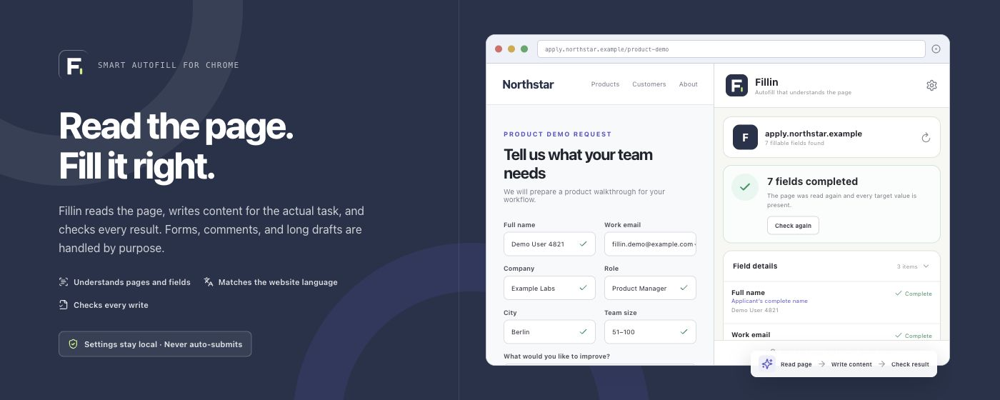

# Fillin — AI Form Filler

[简体中文](README.zh-CN.md)

Fillin is a Manifest V3 Chrome extension that understands the current page, plans what each field needs, writes appropriate values, and verifies the result. It never submits a form for you.



## Features

- Scans inputs, textareas, selects, radio buttons, checkboxes, and rich-text editors.
- Uses labels, ARIA metadata, placeholders, field names, constraints, and nearby copy to understand each field.
- Reads page context before generating task-specific comments, summaries, and long-form content.
- Recognizes article titles and body editors, targets complete long-form drafts, and verifies the actual character count.
- Matches generated content to the website language, including English, Chinese, and German.
- Localizes the extension interface for English and Simplified Chinese Chrome users.
- Works with OpenAI, OpenRouter, DeepSeek, and other OpenAI-compatible `/chat/completions` APIs.
- Supports custom endpoints, models, API keys, reusable profile data, and task-specific instructions.
- Fills every eligible empty field, with clearly synthetic local data as a fallback when AI is unavailable.
- Preserves existing values unless the user explicitly asks Fillin to rewrite them.
- Generates strong values for empty password fields without reading or sending existing passwords.
- Handles common controlled React forms, iframes, and rich-text editors.
- Shows the observe → plan → write → verify loop in the side panel.
- Supports undo and never submits the form.

## Privacy model

Fillin has no developer-operated backend. Your API configuration and optional profile are stored in `chrome.storage.local` on the current device. When you start a fill task, relevant page content, field metadata, your instruction, and the profile you chose to save are sent directly to the AI service configured by you.

Settings survive browser restarts, extension updates, and extension reloads. Chrome removes them when the extension is uninstalled. Fillin can export an unencrypted JSON backup that includes the API key; keep that file on a trusted device.

Remote AI endpoints must use HTTPS. Plain HTTP is allowed only for local development services on `localhost` or `127.0.0.1`.

Read the full [Privacy Policy](PRIVACY.md) and [permission rationale](docs/permissions.md).

## Local development

Requirements:

- Node.js 20 or later
- npm
- Google Chrome or another Chromium browser with Side Panel support

```bash
npm install
npm run dev
```

Vite continuously writes the unpacked extension to `dist`. Open `chrome://extensions`, enable Developer mode, choose **Load unpacked**, and select the `dist` directory.

For later code changes, reload the extension card instead of removing and reinstalling it. Reloading preserves local settings.

Preview only the side panel UI:

```bash
npm run dev:ui
```

Then open `http://127.0.0.1:5173/sidepanel.html`. Preview mode uses deterministic mock fields and does not call a real AI service.

## Build and test

```bash
npm run check
```

This runs the agent-loop, frame-routing, language-generation, endpoint-security, type, and production-build checks. The release-ready extension is written to `dist`.

Useful individual commands:

```bash
npm run type-check
npm test
npm run build
npm run dev:visual
```

## Project structure

```text
src/
├── background/       # Side Panel behavior
├── content/          # Field discovery, highlighting, and writing
├── dev/              # Development-only Chrome API fixtures
├── hooks/            # Page context and agent workflows
├── lib/              # AI requests, planning, browser messaging, and storage
├── shared/           # Cross-context types
└── sidepanel/        # React side panel

tests/visual/          # Reproducible Chrome Web Store artwork
assets/store-listing/ # English and localized store assets
```

## Product boundaries

- File uploads, hidden fields, buttons, and submit controls are not filled.
- Terms, authorizations, and legal-consent checkboxes are not fabricated as accepted.
- Existing password values are never read or sent to AI.
- Synthetic fallback values are intentionally recognizable as test data.
- The user remains responsible for reviewing and submitting every form.

## Contributing

Contributions are welcome. Start with [CONTRIBUTING.md](CONTRIBUTING.md). Please report security issues through the process in [SECURITY.md](SECURITY.md), not through a public issue.

## License

Fillin is available under the [MIT License](LICENSE).
